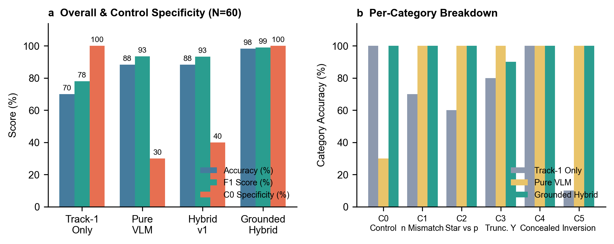
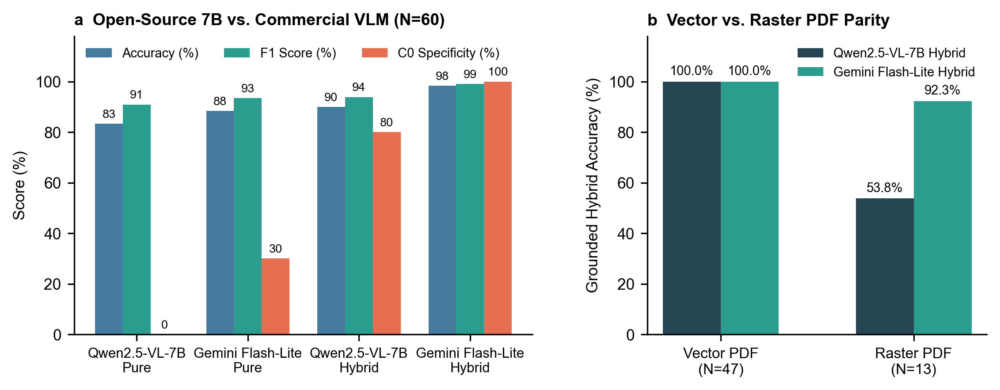

# Bidirectional Grounded Hybrid: Scientific Chart–Text Statistical Consistency Auditor

Automated two-stage auditing pipeline for detecting statistical and visual inconsistencies between scientific figures and their captions/prose claims (e.g., sample size `n` mismatches, significance star vs. `p`-value conflicts, truncated Y-axes, missing error bar definitions, and effect-direction inversions).

---

## Key Results Summary

### 1. Benchmark v1 (`N=60`, 6 Categories × 10 Cases)
| Method | VLM Model | VLM Calls | Accuracy | Precision | Recall | F1 | `C0` Specificity |
| :--- | :--- | :---: | :---: | :---: | :---: | :---: | :---: |
| **Track-1 Only** | — (Deterministic Vector/Rules) | **0** | 0.7000 | **1.0000** | 0.6400 | 0.7805 | **100.0%** (10/10) |
| **Pure VLM** | `gemini-3.5-flash-lite` | 60 | 0.8833 | 0.8772 | **1.0000** | 0.9346 | 30.0% (3/10) |
| **Hybrid v1** | `gemini-3.5-flash-lite` | 28 | 0.8833 | 0.8909 | 0.9800 | 0.9333 | 40.0% (4/10) |
| **Grounded Hybrid** | `gemini-3.5-flash-lite` | **28** | **0.9833** | **1.0000** | 0.9800 | **0.9899** | **100.0%** (10/10) |

### 2. Open-Source Local 7B (`qwen2.5vl:7b` on RTX 3080) vs. Commercial API
| Mode | Model | Accuracy | F1 | Vector PDF (`N=47`) | Raster PDF (`N=13`) | Local Runtime |
| :--- | :--- | :---: | :---: | :---: | :---: | :---: |
| **Pure VLM** | `qwen2.5vl:7b` | 0.8333 | 0.9091 | 83.0% (39/47) | 84.6% (11/13) | 271.1s (4.52s/fig) |
| **Grounded Hybrid** | `qwen2.5vl:7b` | **0.9000** | **0.9388** | **100.0% (47/47)** | 53.8% (7/13) | **94.89s** (3.39s/fig) |
| **Grounded Hybrid** | `gemini-3.5-flash-lite` | **0.9833** | **0.9899** | **100.0% (47/47)** | 92.3% (12/13) | — |




### 3. Real-World Open-Access Paper Audit (arXiv + bioRxiv)
- **78/85 papers parsed** (24 arXiv `q-bio.QM`/`stat.AP` + 54 bioRxiv experimental biology preprints) → **314 figure–caption–prose pairs** extracted.
- **Track-1 triage**: Flagged only **5/314 (1.59%)** candidates for Track-2 VLM review, surfacing real issues including cross-section deferral (`2611.13760v1` Fig 2 → `Appendix D.3`) and underspecified propagated uncertainty (`10.64898/2026.09.30.754978` Fig 6).

---

## Repository Structure

```text
├── README.md
├── requirements.txt
├── .gitignore
├── src/
│   ├── 01_mvp_benchmark_generator.py        # MVP synthetic cases (C0-C5)
│   ├── 04_vector_geometry_auditor.py        # Track-1 PDF vector geometry + prose parser
│   ├── 05_benchmark_v1_generator.py         # Benchmark v1 (N=60, vector + raster PDFs)
│   ├── 06_eval_rule_baseline.py             # Track-1 baseline evaluation
│   ├── 07_eval_vlm_and_hybrid.py            # Pure VLM & Hybrid v1 (Gemini)
│   ├── 08_eval_grounded_hybrid.py           # Bidirectional Grounded Hybrid (Exp-06)
│   ├── 09_plot_ablation_results.py          # Generates Figure 1
│   ├── 10_real_paper_figure_extractor.py    # Cross-page real PDF figure-caption extractor
│   ├── 11_audit_real_papers.py              # Track-1 real-paper statistical regex checks
│   ├── 12_scale_real_paper_triage.py        # 25-paper arXiv triage (Exp-11)
│   ├── 13_track2_local_vlm_audit.py         # Local Ollama qwen2.5vl:7b Track-2 verifier (Exp-12)
│   ├── 14_eval_local_vlm_benchmark.py       # Local 7B Benchmark v1 evaluation (Exp-13)
│   ├── 15_plot_open_vs_commercial.py        # Generates Figure 2 (Exp-14)
│   └── 16_biorxiv_biomed_audit.py           # 60-paper bioRxiv two-stage audit (Exp-15)
├── tests/
│   └── test_audit_pipeline.py               # Unit tests for extraction, regexes & report consistency
├── figures/                                 # Publication-ready PDF/PNG figures
├── data/                                    # Benchmark metadata & JSON evaluation reports
└── notes/
    ├── research-final-report.md             # Full research summary report (Traditional Chinese)
    ├── phase1-2-results-summary.md          # Phase 1-2 benchmark summary
    └── literature-notes.md                  # Literature review notes
```

---

## Quickstart & Reproduction

```bash
# 1. Install dependencies
pip install -r requirements.txt

# 2. Run unit tests
python -m unittest discover -s tests -v

# 3. (Optional) Local Open-Source Track-2 VLM via Ollama
ollama pull qwen2.5vl:7b
python src/14_eval_local_vlm_benchmark.py

# 4. (Optional) Commercial VLM via Gemini API
# Create .env with GEMINI_API_KEY=your_key (gitignored)
python src/08_eval_grounded_hybrid.py
```

---

## Documentation
- **Final Report**: [notes/research-final-report.md](notes/research-final-report.md)
- **Phase 1–2 Summary**: [notes/phase1-2-results-summary.md](notes/phase1-2-results-summary.md)

## Dependencies & Attribution
This project builds on standard open-source libraries (`PyMuPDF`, `Pillow`, `Matplotlib`, `NumPy`, `Requests`) and evaluates open-weight (`Qwen2.5-VL-7B` via Ollama) alongside commercial (`Gemini 3.5 Flash-Lite`) VLMs. All benchmark generation, PDF vector/text auditing logic, and two-stage triage pipelines in `src/` and `tests/` are original implementations.
